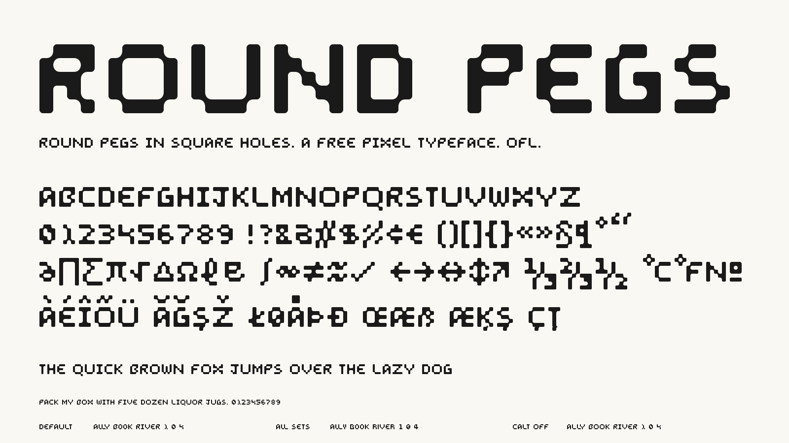

# Edge Case



**Edge Case** is a free, open-source pixel typeface with rounded cells and concave
fillets where cells join diagonally. It is drawn on a grid of whole and half cells,
so it stays crisp at 16px multiples. It is a capitals-only design: lowercase letters
map to the same shapes.

Designed by Tejas at [3 Sided Coin](https://3sided.co.in). Formerly "Shade Pixel".

## Coverage

- Basic Latin, Latin-1 Supplement and most of Latin Extended-A and B used by European languages
- Accented capitals composed from consistent marks, plus combining marks via OpenType `mark` positioning
- ẞ, Æ, Œ, Ø, Ł, Ħ, Þ, Ð, and common punctuation, arrows and currency symbols
- Not yet drawn: Vietnamese stacked-mark letters

## Download

Fonts are in [`fonts/`](fonts): `otf/`, `ttf/` and `webfonts/` (WOFF, WOFF2).

## Using it

Best at multiples of 16px (cell = 1/8 em). At multiples of 8px, whole-cell
shapes are crisp but half-cell marks (e.g. some accents) fall on half pixels.
Turn off font smoothing or use `image-rendering: pixelated` canvases for exact pixels.

```css
@font-face {
  font-family: "Edge Case";
  src: url("fonts/webfonts/EdgeCase-Regular.woff2") format("woff2");
}
```

## Building

Glyphs are SVGs in [`sources/svg`](sources/svg), drawn on a 4-unit-per-cell grid.

```sh
pip install -r requirements.txt
python3 -I sources/build.py
python3 -I sources/release.py "Edge Case" 1.007 https://github.com/3sidedcoin/edge-case-typeface
```

Output goes to `build-out/`. See [`documentation/DESIGN.md`](documentation/DESIGN.md) for the drawing rules.

## Contributing

Issues and pull requests are welcome. Please keep new glyphs on the cell grid and
follow the rules in `documentation/DESIGN.md`. By contributing you agree your work is
released under the OFL.

## License

Licensed under the SIL Open Font License, Version 1.1. See [OFL.txt](OFL.txt).
This applies to the font software and the source files in this repository.
